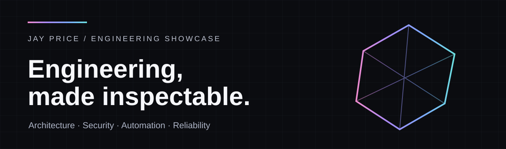

<div align="center">



<br/>

### JAY PRICE
**Systems Architect · Software Engineer · Technical Consultant**

*I connect operational reality with technical execution—then make the decisions inspectable.*

[**START WITH THE ENGINEERING REVIEW →**](docs/ENGINEERING-REVIEW.md) &nbsp;&nbsp; [**TRACE THE EVIDENCE →**](evidence/INDEX.md) &nbsp;&nbsp; [**FIVE-MINUTE REVIEW →**](docs/REVIEWER-GUIDE.md)

<br/>

`SYSTEMS ARCHITECTURE` &nbsp; `SOFTWARE ENGINEERING` &nbsp; `SECURE INTEGRATIONS` &nbsp; `AUTOMATION` &nbsp; `RELEASE INTEGRITY`

</div>

---

<table>
<tr><td width="56%" valign="top">

### THE POINT OF VIEW

## I don't just ask whether a system works.<br/>I ask what makes it trustworthy.

My work sits at the intersection of **architecture, implementation, and operational integrity**. I translate complicated requirements into explicit system boundaries, testable decisions, and software that can be examined beyond the happy path.

A recurring engineering principle runs through this portfolio:

**No consequential state transition without evidence that it is valid.**

</td><td width="44%" valign="top">

### ENGINEERING SIGNATURE

**01 / Think in systems**  
Interfaces, dependencies, identity, failure paths.

**02 / Engineer the boundary**  
Authenticate, validate, and reject unsafe assumptions.

**03 / Prove the behavior**  
Runnable tests, negative cases, explicit limits.

**04 / Design for operations**  
Readiness, reversibility, traceability, review.

</td></tr>
</table>

<br/>

## SOURCE-REVIEWED ENGINEERING / BEYOND DEMONSTRATIONS

**Four case studies from existing engineering source** — release verification versus production acceptance, provider-independent validation, testable publication standards, and the distinction between publication and transactional readiness. Each case identifies the engineering problem, the observed implementation, its significance, and what remains unverified. Private source and sensitive configuration are not reproduced.

[**EXPLORE THE SOURCE-REVIEWED CASE STUDIES →**](evidence/SOURCE-REVIEWED-CASE-STUDIES.md)

### ARCHIVED VERIFICATION / ACTUAL REPORTED RESULTS

An archived October 2026 engineering log records **41 passing identity/API security checks**, **26 passing enterprise release contract tests**, and **5 passing governance-integrity tests**. A separate release-evidence record explicitly reports **BLOCKED** deployment readiness and **NOT REVENUE READY**. These are historical source observations—not newly executed tests or proof of current production health.

[**INSPECT THE SCOPED VERIFICATION RECEIPTS →**](evidence/HISTORICAL-VERIFICATION-RECEIPTS.md)

## SELECTED WORK / THE PROOF IS IN THE DECISION

<table>
<tr>
<td width="33%" valign="top">

### 01 · TRUST
**Secure event intake**

An external event is not trustworthy because it resembles a valid payload.

**Engineering decision:** bind a timestamp and message to an HMAC signature; reject tampering, stale events, and malformed signatures.

[**SOURCE ↗**](examples/webhook-verification/index.js) · [TESTS ↗](examples/webhook-verification/index.test.js)

</td>
<td width="33%" valign="top">

### 02 · ORCHESTRATION
**Workflow state integrity**

Real systems receive repeated events and unexpected sequences.

**Engineering decision:** define valid state transitions explicitly and recognize previously processed event IDs.

[**SOURCE ↗**](examples/workflow-engine/index.js) · [TESTS ↗](examples/workflow-engine/index.test.js)

</td>
<td width="34%" valign="top">

### 03 · RELEASE INTEGRITY
**Evidence-led admission**

Missing evidence is not the same as successful verification.

**Engineering decision:** require every declared acceptance signal to be explicitly satisfied before reporting readiness.

[**SOURCE ↗**](examples/release-gate/index.js) · [TESTS ↗](examples/release-gate/index.test.js)

</td>
</tr>
</table>

### 04 · DECISION PROVENANCE

**Evidence-bound decision history** — a new, independently inspectable demonstration of hash-chained, HMAC-authenticated decision records. The implementation requires an explicit decision and evidence references, then verifies record sequence and detects tampering. It deliberately does not claim durable audit-log or nonrepudiation guarantees.

[**IMPLEMENTATION ↗**](examples/decision-ledger/index.js) &nbsp;·&nbsp; [**NEGATIVE TESTS ↗**](examples/decision-ledger/index.test.js) &nbsp;·&nbsp; [**DESIGN TRADEOFFS ↗**](examples/decision-ledger/README.md)

> **What makes these examples useful:** Each implementation is deliberately small enough to audit. The accompanying [engineering review](docs/ENGINEERING-REVIEW.md) explains the tradeoffs, failure boundaries, and what would need to change for a production system.

<br/>

## CAPABILITIES / FROM REQUIREMENT TO RELIABLE EXECUTION

| Engineering domain | The problems I work on |
| :--- | :--- |
| **Systems architecture** | Service interfaces, identity boundaries, dependency mapping, deployment separation, integration design |
| **Software engineering** | Application and API logic, error handling, maintainable implementations, testable contracts |
| **Security-minded engineering** | Message authentication, input validation, trust boundaries, deliberate rejection behavior |
| **Automation & orchestration** | Workflow transitions, event handling, repeatable verification, operational sequencing |
| **Release & technical governance** | Acceptance gates, change integrity, traceable readiness decisions, reversible execution |
| **AI engineering & integration** | AI-enabled workflow architecture, evaluation design, human-review and approval boundaries |

<br/>

## ENGINEERING METHOD / PURPOSE FIRST

<div align="center">

### PURPOSE &nbsp; → &nbsp; OUTCOME &nbsp; → &nbsp; ACTION &nbsp; → &nbsp; PROCESS &nbsp; → &nbsp; SUPPORT

**The technical solution should serve the outcome—not become the outcome.**

</div>

I start with the actual requirement, identify constraints and dependencies, define the acceptance conditions, and test failure behavior with the same seriousness as expected behavior.

<br/>

## REVIEW IT YOURSELF

```bash
npm test
```

**Node.js 20+** · No third-party packages · No credentials · No external services

| Read | Why it matters |
| :--- | :--- |
| [Engineering review](docs/ENGINEERING-REVIEW.md) | Architectural decisions, threat boundaries, and tradeoffs |
| [Advancement notes](docs/ADVANCEMENT-NOTES.md) | Four specific engineering decisions, linked to source, tests, and limitations |
| [Source-reviewed case studies](evidence/SOURCE-REVIEWED-CASE-STUDIES.md) | Four observed engineering implementations, their significance, and precise evidence limits |
| [Historical verification receipts](evidence/HISTORICAL-VERIFICATION-RECEIPTS.md) | Archived test counts, release blockers, and explicitly bounded conclusions |
| [Evidence matrix](evidence/INDEX.md) | Direct trace from capability to implementation and tests |
| [Reviewer guide](docs/REVIEWER-GUIDE.md) | A concise path for engineering leaders to inspect the work |
| [Publication standard](docs/PUBLICATION.md) | Clear boundaries around sensitive information and claims |

<br/>

---

<div align="center">

### JAY PRICE
**Engineer the system. Substantiate the decision. Own the outcome.**

Software engineering · Systems architecture · Technical consulting

<sub>This public portfolio contains original, synthetic demonstrations—not copied private implementations. They demonstrate engineering methods and do not establish historical production deployments, client results, or independent certifications. Private system architecture, customer information, and credentials are excluded.</sub>

</div>
