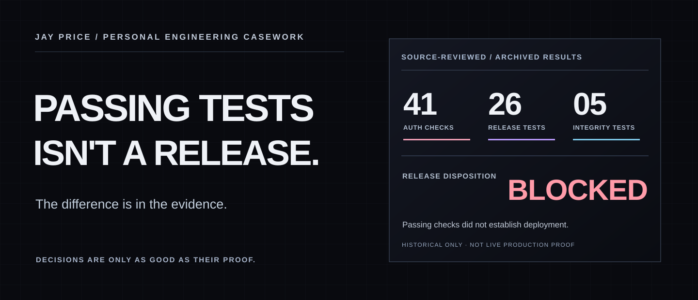

<div align="center">

<picture>
  <source media="(max-width: 680px)" srcset="assets/jay-price-casework-mobile-v2.svg">
  
</picture>

*I turn complicated requirements into software that can be examined, tested, and trusted.*

[Explore the engineering cases](evidence/SOURCE-REVIEWED-CASE-STUDIES.md) &nbsp;·&nbsp; [Inspect the evidence](evidence/HISTORICAL-VERIFICATION-RECEIPTS.md)

</div>

---

## What the green check doesn't tell you

I care about the questions that appear after someone says, “It works.”

Does a passing build mean the right revision is live? What happens when a downstream service never confirms delivery? Can a visual approval still be trusted after the source changes? Who decides when a release has enough evidence to proceed?

Those questions have shaped engineering work I've reviewed and developed. The four cases below describe specific implementation decisions from existing source, with identifying details removed.

### A passing build wasn't a release
Validation passed, but publication still needed its own evidence. The implementation separated source checks, release admission, execution, and readback. The historical record preserved a blocked release despite successful tests.

[**Read the case →**](evidence/SOURCE-REVIEWED-CASE-STUDIES.md#a-passing-build-was-not-a-release)

### A green status wasn't the whole answer
An external status indicator could report a check result without proving that the complete acceptance standard had been met. Verification requirements were defined separately and checked explicitly.

[**Read the case →**](evidence/SOURCE-REVIEWED-CASE-STUDIES.md#when-a-status-indicator-became-the-wrong-source-of-truth)

### A finished-looking page could still fail
The reviewed validator examined structure, assets, placeholder actions, and evidence associated with a specific source revision. Visual approval and technical acceptance were treated as different requirements.

[**Read the case →**](evidence/SOURCE-REVIEWED-CASE-STUDIES.md#a-page-could-look-finished-and-still-fail-acceptance)

### A successful request wasn't a confirmed delivery
Failure-path tests distinguished an accepted request from a completed downstream action. A mocked transport passed a smoke test, but the record did not claim that live delivery had succeeded.

[**Read the case →**](evidence/SOURCE-REVIEWED-CASE-STUDIES.md#an-integration-was-functional-in-tests-but-not-proven-end-to-end)

---

## What you can inspect here

The case studies are drawn from existing engineering source and historical records. The following code is **separately authored public demonstration material**—useful for examining the same kinds of decisions, but not presented as the original project source.

| Demonstration | What it shows | Code |
| --- | --- | --- |
| **Authenticating external events** | Timestamp-bound HMAC validation and deliberate rejection paths | [Implementation](examples/webhook-verification/index.js) · [Tests](examples/webhook-verification/index.test.js) |
| **Preserving workflow state** | Explicit transitions and duplicate-event handling | [Implementation](examples/workflow-engine/index.js) · [Tests](examples/workflow-engine/index.test.js) |
| **Requiring release evidence** | Fail-closed readiness decisions | [Implementation](examples/release-gate/index.js) · [Tests](examples/release-gate/index.test.js) |
| **Binding decisions to evidence** | Hash-chained, authenticated decision records | [Implementation](examples/decision-ledger/index.js) · [Tests](examples/decision-ledger/index.test.js) |

Run the demonstrations with Node.js 20+:

```bash
npm test
```

No third-party dependencies or credentials are required. These public tests have not been represented as independent verification of the original engineering work.

## What I bring to engineering work

**Architecture:** I look at boundaries, dependencies, failure modes, and how one technical decision affects the rest of a system.

**Software:** I turn requirements into interfaces, validation rules, application behavior, and tests that expose incorrect assumptions.

**Security and reliability:** I care about what a system rejects, what it records, and what evidence is needed before advancing a consequential state.

**Integration and automation:** I distinguish attempted actions from confirmed outcomes and design workflows around that distinction.

**Technical judgment:** I don't confuse a polished interface, a green check, or a successful unit test with proof that everything works end to end.

---

<div align="center">

**JAY PRICE**

*Make complexity answer to evidence.*

[Engineering casework](evidence/SOURCE-REVIEWED-CASE-STUDIES.md) · [Historical evidence summary](evidence/HISTORICAL-VERIFICATION-RECEIPTS.md) · [Technical review](docs/ENGINEERING-REVIEW.md)

<sub>Public case narratives are anonymized. Private source, identifying operational details, and business information are intentionally excluded. Historical test results are labeled as historical; live outcomes are not assumed.</sub>

</div>
