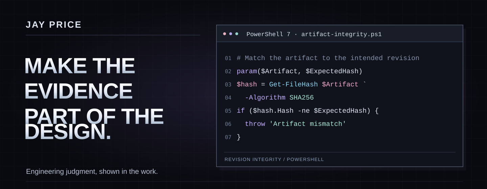

<div align="center">

<picture>
  <source media="(max-width: 680px)" srcset="assets/jay-price-powershell-mobile.svg">
  
</picture>

*I translate complex requirements into systems, software, and engineering decisions that can be examined and trusted.*

[Engineering casework](evidence/SOURCE-REVIEWED-CASE-STUDIES.md) · [Technical implementations](docs/ENGINEERING-REVIEW.md) · [Verification highlights](evidence/HISTORICAL-VERIFICATION-RECEIPTS.md)

</div>

---

## Engineering work that speaks for itself

My focus is the reasoning behind the implementation: the boundaries, validation rules, failure paths, and verification evidence that make technical decisions dependable.

### Release integrity and revision verification
**Exact revisions. Explicit acceptance. Verifiable publication.**

I examined release logic that connected source validation, release admission, publication, and readback to the intended revision. That separation makes release evidence traceable from the code being evaluated to the artifact being served.

[Explore the case](evidence/SOURCE-REVIEWED-CASE-STUDIES.md#release-integrity-and-revision-verification)

### Independent verification across execution environments
**Defined technical standards instead of ambiguous status indicators.**

The reviewed source defined executable validation rules and acceptance conditions, including checks for unsupported legacy workflow paths. The result is a clearer contract for evaluating engineering readiness across systems.

[Explore the case](evidence/SOURCE-REVIEWED-CASE-STUDIES.md#independent-verification-across-execution-environments)

### Revision-bound interface acceptance
**Visual decisions connected to actual source state.**

The reviewed interface validator connected structure, asset verification, viewport requirements, and approved visual evidence to particular source revisions. This brings design review and technical validation into the same evidence trail.

[Explore the case](evidence/SOURCE-REVIEWED-CASE-STUDIES.md#revision-bound-interface-acceptance)

### Reliable integration state transitions
**Accurate state, deliberate transitions, recoverable failure paths.**

The reviewed integration tests covered request validation, downstream response handling, and preservation of intake records. The implementation distinguished receipt from confirmed delivery, protecting data integrity across a multistep workflow.

[Explore the case](evidence/SOURCE-REVIEWED-CASE-STUDIES.md#reliable-integration-state-transitions)

---

## Inspect the engineering

These implementations let you explore the decisions in code, not just read about them.

| Focus | Technical implementation | Source and tests |
| --- | --- | --- |
| **Event authentication** | Timestamp-bound HMAC authentication and rejection rules | [Implementation](examples/webhook-verification/index.js) · [Tests](examples/webhook-verification/index.test.js) |
| **State integrity** | Defined workflow transitions and duplicate-event handling | [Implementation](examples/workflow-engine/index.js) · [Tests](examples/workflow-engine/index.test.js) |
| **Release admission** | Explicit evidence requirements and readiness checks | [Implementation](examples/release-gate/index.js) · [Tests](examples/release-gate/index.test.js) |
| **Decision integrity** | Evidence references and hash-linked authenticated records | [Implementation](examples/decision-ledger/index.js) · [Tests](examples/decision-ledger/index.test.js) |

Run the public examples with Node.js 20+:

```bash
npm test
```

## Verification highlights

Selected source-reviewed historical records include:

| Review area | Recorded result |
| --- | ---: |
| Authentication and authorization | **41 passed · 0 failed** |
| Release-contract tests | **26 passed · 0 failed** |
| Evidence-integrity tests | **5 passed · 0 failed** |
| Source views examined | **36** |
| Source links checked | **267** |
| Asset references checked | **43** |
| Dependency components scanned | **289** |

[Explore the verification records](evidence/HISTORICAL-VERIFICATION-RECEIPTS.md)

---

## The capabilities I bring

**Systems design and software engineering.** Requirements decomposition, interface contracts, state management, validation logic, and implementation review.

**Security-minded development.** Input authentication, integrity checks, rejection paths, and evidence-linked technical decisions.

**Integration and automation.** Cross-system workflows, fault handling, state transitions, repeatable verification, and PowerShell-centered engineering practices.

**Technical governance and reliability.** Traceable revisions, audit-ready decisions, acceptance standards, and practical release discipline.

---

<div align="center">

**JAY PRICE**

*Technical judgment, made visible.*

[Casework](evidence/SOURCE-REVIEWED-CASE-STUDIES.md) · [Code](docs/ENGINEERING-REVIEW.md) · [Verification](evidence/HISTORICAL-VERIFICATION-RECEIPTS.md)

<sub>Disclosure: Case studies are anonymized accounts based on reviewed engineering source; public code examples are independent demonstrations, and verification figures reflect archived records.</sub>

</div>
